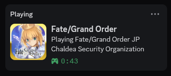

# Waydroid Presence

Discord Rich Presence for Android applications running in Waydroid, using ADB.

**Version:** 0.6.0  
**Initial target:** Arch Linux x86_64. Designed to run as a normal desktop user, with no root daemon and no `sudo` during installation or operation.

## Screenshots




## Zero-root principles

- The Python daemon always runs as the logged-in user.
- Integration uses the user's ADB server and authorized Waydroid ADB device.
- Startup is managed by `systemd --user`.
- Configuration and logs live in the user's home directories.
- No root service, privileged helper, shared `/tmp` state file, or elevated installer is used.
- The user service applies additional systemd sandboxing where compatible with desktop Discord IPC and ADB.

If a future feature appears to require root, the project should first seek an unprivileged ADB, user-session, or Waydroid interface instead.

See [`CHANGELOG.md`](CHANGELOG.md) for version history.

## Features in 0.6.0

- Package-keyed application database: known Android packages automatically get the correct Discord image and display name, with no per-app configuration.
- Layered lookup: explicit `apps.custom` override, then the user database (`~/.local/share/waydroid-presence/apps.json`), then the bundled seed, then the global default icon.
- Database icons are public `https://` URLs, so each game does not need an uploaded Rich Presence asset.
- The database also supplies the Discord activity name, so games are named automatically on clients that honor the RPC `name` field (Vesktop, Equibop, Vencord).
- Database entries may carry their own `client_id`, which makes the official Discord client switch applications (and therefore names/assets) per game automatically.
- Optional Google Play discovery: unknown packages are looked up in the background and cached, or on demand with `--db-fetch`.
- Database management commands: `--db-path`, `--db-lookup`, `--db-fetch`, `--db-set`, `--db-remove`.
- Configurable display name for the Discord Developer Application shown in the activity.
- Optional per-Android-app `client_id` to use a different Discord Developer Application (and therefore a different displayed name and asset library).
- Detects the focused Android package through `adb shell dumpsys window`.
- Automatic selection of the only authorized ADB device or explicit serial selection.
- Discord IPC reconnection and periodic activity refresh to detect Discord restarts without restarting the Android app.
- Clears stale activity after a configurable ADB outage timeout, then republishes the current app when ADB recovers.
- Avoids sending duplicate activity payloads when nothing changed.
- Per-app details, state, large icon, large-icon tooltip, optional small icon and up to two activity buttons.
- Configurable idle and ADB-unavailable behavior, including a stale-presence timeout.
- Separate runtime coordinator, ADB detector, configuration loader, app metadata and Discord RPC modules.
- Better configuration validation; `--current` no longer requires a Discord Client ID.
- User-level systemd service with basic hardening.
- Live configuration reload: valid YAML changes are applied without restarting the daemon; invalid edits are rejected while the last working configuration remains active.
- ADB package inventory through `--packages`, with `--user`, `--system` and case-insensitive `--search TEXT` filters.
- Read-only environment diagnostics through `--doctor` (configuration, ADB, foreground detection, Discord IPC and user systemd service).
- YAML profile starter generation through `--profile-template PACKAGE`.
- Diagnostic commands: `--current`, `--packages`, `--validate-config`, `--test`, and `--version`.

## Requirements

- Waydroid installed and initialized.
- Python 3.10 or newer.
- `adb` (`android-tools` on Arch).
- Discord desktop client running for local Discord IPC.
- A Discord application Client ID. Rich Presence art assets are only required for the default/idle icon and for custom asset keys; database entries use public image URLs instead.

Connect to the Waydroid ADB endpoint if it is not already connected:

```bash
adb connect WAYDROID_IP:5555
adb devices -l
```

The Waydroid device should appear with state `device`. Run ADB as your normal user, not with `sudo`.

## Install or update (no sudo)

```bash
git clone https://github.com/Nof1m/waydroid-presence
cd waydroid-presence
chmod +x scripts/install.sh
./scripts/install.sh
```

For an existing installation, run the same installer from the new source directory. It updates the application and user service while preserving your existing configuration. It creates/uses a virtual environment under `~/.local/share/waydroid-presence`.

Edit the configuration:

```bash
nano ~/.config/waydroid-presence/config.yaml
```

Set `discord.client_id`, then restart:

```bash
systemctl --user restart waydroid-presence.service
systemctl --user status waydroid-presence.service
journalctl --user -u waydroid-presence.service -f
```

## Diagnostics

```bash
~/.local/share/waydroid-presence/.venv/bin/waydroid-presence --version
~/.local/share/waydroid-presence/.venv/bin/waydroid-presence --validate-config
~/.local/share/waydroid-presence/.venv/bin/waydroid-presence --current
~/.local/share/waydroid-presence/.venv/bin/waydroid-presence --packages
~/.local/share/waydroid-presence/.venv/bin/waydroid-presence --packages --user
~/.local/share/waydroid-presence/.venv/bin/waydroid-presence --packages --system
~/.local/share/waydroid-presence/.venv/bin/waydroid-presence --packages --search fate
~/.local/share/waydroid-presence/.venv/bin/waydroid-presence --doctor
~/.local/share/waydroid-presence/.venv/bin/waydroid-presence --profile-template com.example.game
~/.local/share/waydroid-presence/.venv/bin/waydroid-presence --db-path
~/.local/share/waydroid-presence/.venv/bin/waydroid-presence --db-lookup com.aniplex.fategrandorder
~/.local/share/waydroid-presence/.venv/bin/waydroid-presence --db-fetch com.example.game
~/.local/share/waydroid-presence/.venv/bin/waydroid-presence --test
```

`--current` prints the focused package or `idle`; `--packages` lists package IDs installed in Waydroid. `--packages --user` uses Android Package Manager's `-3` filter (third-party/user-installed apps); `--packages --system` uses `-s`; `--search TEXT` filters IDs case-insensitively. These inventory commands work without a Discord Client ID. `--doctor` performs read-only checks and reports failures/warnings. `--profile-template PACKAGE` prints a YAML snippet to paste under `apps.custom` (it does not modify the configuration automatically). `--test` checks ADB detection and Discord IPC connectivity.

## Configuration

See [`config/config.yaml`](config/config.yaml). Main options:

- `adb.device: auto`: requires exactly one authorized ADB device. Set a serial to select one explicitly.
- `presence.idle_behavior`: `clear` or `show_idle`.
- `presence.unavailable_behavior`: `keep` or `clear`.
- `presence.unavailable_clear_after`: seconds before stale activity is cleared during ADB loss when behavior is `keep` (default 30; set 0 to disable timeout).
- `discord.presence_refresh_interval`: seconds between activity refreshes to detect Discord restarts (default 15).
- `runtime.config_reload_interval`: seconds between configuration file checks (default 3). Valid changes are applied live; invalid changes are logged and ignored.
- `apps.custom`: per-package activity customization.
- `discord.application_name`: optional display-name override sent in the activity `name` field. Vesktop/Vencord display it; the official Discord client ignores it and keeps showing the Developer Application name.
- `apps.custom.<package>.application_name`: per-app version of the same override.
- `apps.custom.<package>.client_id`: optional numeric Discord application ID used only while that Android app is focused. This is the reliable way to change the displayed application name on the official Discord client: create another Developer Application, rename it as desired, configure its Rich Presence assets, and paste its ID here. The daemon switches the RPC connection when the foreground app changes and returns to `discord.client_id` on idle.
- `apps.custom.<package>.icon`: large image for that Android app. Accepts a Discord application asset key or a public `http(s)` URL, and overrides the application database. Asset keys must belong to the application selected for that Android app.
- `database.auto_lookup`: look up unknown packages on Google Play in the background (default `true`). Set to `false` for fully offline behavior.
- `database.timeout`: seconds allowed per lookup (default 8).
- `database.cooldown`: seconds before retrying a package whose lookup failed (default 600).
- `small_image` and `small_text`: optional small image and tooltip.
- `buttons`: optional list of up to two `{label, url}` activity buttons.

Asset keys must already exist in the application's Rich Presence Art Assets; public URLs do not. Activity buttons must use URLs accepted by Discord.

### Changing the application name

The name shown next to “Playing” comes from the Discord Developer Application tied to the client ID. There are three options:

- **Automatic per game:** known packages use their database name. On clients that honor the RPC `name` field (Vesktop, Equibop, Vencord) this just works; on the official client add a `client_id` to the database entry so the runtime switches applications per game.
- **Official Discord client:** rename the application in the Discord Developer Portal, or set `apps.custom.<package>.client_id` to another application whose name you want. The latter allows a different name (and different assets) per Android app.
- **Vesktop/Vencord:** `discord.application_name` or `apps.custom.<package>.application_name` can override the displayed name through the RPC `name` field. Vanilla Discord ignores this field.

All of these options run as the normal desktop user and use the same unprivileged ADB/User IPC model; no root or extra permissions are required.

## Application image database

Waydroid Presence ships a database keyed by Android package name, so known apps
display the correct image and name automatically. Nothing needs to be uploaded to
the Discord Developer Portal: database icons are public `https://` URLs that
Discord fetches and caches.

Lookup precedence for the large image and display name:

1. `apps.custom.<package>` in `config.yaml` (explicit override)
2. your user database at `~/.local/share/waydroid-presence/apps.json`
3. the bundled seed database shipped with the package
4. `presence.default_icon_key` / the package name

Manage the database with the installed binary:

```bash
PRESENCE=~/.local/share/waydroid-presence/.venv/bin/waydroid-presence

# where is the user database, and how many entries does it have?
$PRESENCE --db-path

# what would be published for this package? (includes config.yaml overrides)
$PRESENCE --db-lookup com.aniplex.fategrandorder

# add or correct an entry; a running daemon picks it up on its next refresh
$PRESENCE --db-set com.example.game \
  --db-icon https://cdn.example/icon.png \
  --db-name "Example Game"

# let Google Play fill name and icon for an unknown package
$PRESENCE --db-fetch com.example.game

# give a package its own Discord application (official client: changes the name)
$PRESENCE --db-set com.example.game --db-client-id 123456789012345678

# drop your override and fall back to the bundled entry
$PRESENCE --db-remove com.example.game
```

`--db-set` updates only the fields you pass, so you can replace just the icon and
keep the bundled name. The user database is plain JSON and survives installer updates:

```json
{
  "version": 1,
  "apps": {
    "com.example.game": {
      "name": "Example Game",
      "icon": "https://cdn.example/icon.png",
      "application_name": "Example Game",
      "client_id": "123456789012345678"
    }
  }
}
```

Only `name` and `icon` are normally needed; `--db-fetch` fills both. `icon`
accepts a public `http(s)` URL or a Discord asset key. A missing or broken user
database is logged and ignored at runtime, so presence keeps working with the
bundled entries.

### Automatic names per game

The activity name comes from the Discord Developer Application, so it changes
per game in one of two ways:

- **Clients that honor the RPC `name` field** (Vesktop, Equibop, Vencord): the
  database name is used automatically, with no configuration. Precedence is
  `apps.custom.<package>.application_name`, then `discord.application_name`, then
  the database `application_name`/`name`.
- **Official Discord client:** the `name` field is ignored and only the
  Developer Application decides the title. Add a `client_id` to the database
  entry (`--db-set PACKAGE --db-client-id ID`) and the runtime switches
  applications while that game is focused, then returns to `discord.client_id`
  on idle. Each Discord application must be created manually in the Developer
  Portal, so this is only worth it for the games you care about most.

### Automatic lookups

With `database.auto_lookup: true` (the default), every focused package with no
database entry is looked up on the public Google Play listing in a background
thread. The discovered name and icon are cached in the user database and the
activity is refreshed immediately. Only the package name is sent to Google, and
failed lookups are retried after `database.cooldown` seconds. Set
`auto_lookup: false` to keep everything offline and use `--db-fetch` manually.

### Where the bundled entries come from

The seed covers a small curated set of popular games. Icons are taken from each
app's public Google Play listing (the `og:image` URL, requested at 512px), and the
package IDs are verified against that listing. It is a starter list, not an
exhaustive catalog: add the games you play with `--db-set`, or open a pull request
adding them to `src/waydroid_presence/data/apps.json`.

## Uninstall

```bash
./scripts/uninstall.sh
```

Configuration and logs are preserved. To remove those too:

```bash
./scripts/uninstall.sh --purge
```

## Development and tests

```bash
python -m venv .venv
source .venv/bin/activate
pip install -e '.[dev]'
pytest
```

## Project status

Early development. Version 0.1.0 was tested by the project user on Arch Linux: Discord displayed the activity and no journal errors were noticed. Versions 0.2.1 and 0.3.0 have been exercised through automated tests. The project user validated the 0.2.1 Discord restart, ADB outage timeout and ADB recovery flows on Arch Linux, and validated the 0.3.0 package inventory on the same machine. Version 0.4.0 package filters, doctor and profile template require validation on the target machine. Version 0.5.0 application-name and per-app client ID options require validation on the target machine.

## Licensing and upstream

This project is distributed under the MIT License. See [LICENSE](LICENSE) for the full text.
